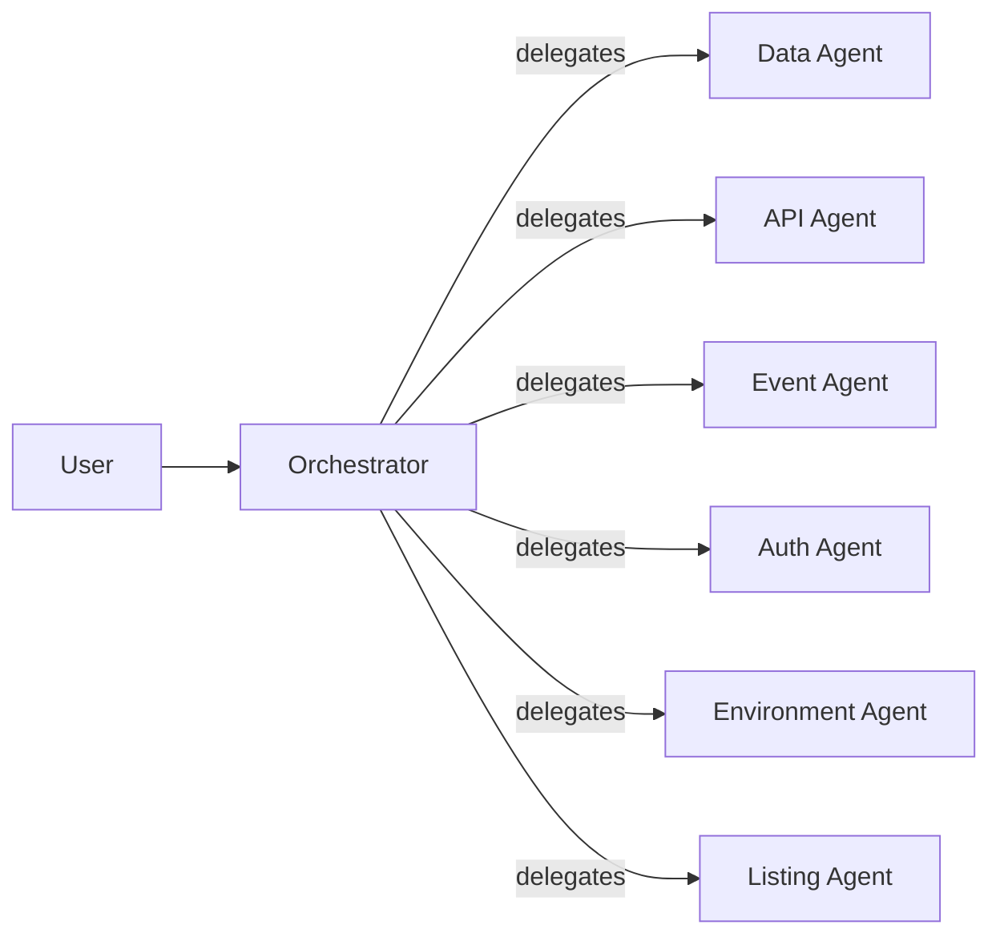

# Agent Layer

The AI components that operate inside and alongside a Jungle. For the term itself see [`../glossary.md#agent-layer`](../glossary.md#agent-layer); for how agents fit the broader system see [`./system-context.md`](./system-context.md). The response contract referenced below is pinned in [`../decisions/0002-sub-agent-response-contract.md`](../decisions/0002-sub-agent-response-contract.md).

## Two roles, not one bucket

Agents in a Jungle divide into two distinct roles. They share a deployment surface; they do not share a responsibility.

- **Operational agents** *modify* the system. Builder/modifier agents change code, schema, UI. A future clicker agent exercises the UI. User-simulation agents generate persona-based feedback. Their output is action — edits, clicks, interactions.
- **Inspection specialists** *explain and validate* the system. One per domain: Data, API, Event, Auth, Environment, Listing. Their output is structured answers grounded in real state, not action.

This doc is about inspection specialists. Operational agents warrant their own doc when there is real material to commit to.

## The pattern

Users do not address specialists directly. A single **orchestrator** fronts all of them and handles routing, collection, and rendering.



What each half does:

- **The orchestrator** recognizes which domain a question belongs to, delegates to the specialist with the relevant context (current environment, current app, any identifiers the specialist will need), collects the specialist's structured response, and renders it to the user in plain language — including source or evidence when it helps.
- **A specialist** owns inspection for exactly one domain. It is invoked, it checks real state through its tools, it returns a structured response. It does not talk to the user directly and it does not call other specialists. Cross-domain composition is the orchestrator's job.

The orchestrator coordinates. The specialists verify.

## The inspection-surface principle

This is the guardrail that keeps the pattern from degenerating into eloquent lying.

> Each specialist must be attached to a real inspection surface, not prompt memory.

A Data Agent that "remembers" which datasets are connected is worse than no Data Agent. It will answer confidently, cite nothing checkable, and be wrong whenever state has changed since its prompt was composed. The same is true for every other specialist.

Concretely, an inspection surface means the specialist has programmatic access to the live truth of its domain: current connection config, a queryable schema registry, actual queue depth, real health-check endpoints, the current deployment manifest, the live Gallery listing record inside the Canopy. If a claim appears in a specialist's `summary`, its `evidence` must point at something another human could independently check.

A specialist with no inspection surface is not a specialist. It is a liability with a hard hat on.

## The specialists

Each row lists the domain owned, the kind of question the specialist answers, and the minimum inspection surface it must reach to answer credibly. Concrete tool shapes (SDK calls, endpoints, schemas) are a per-specialist decision when that specialist is actually built.

| Specialist | Answers questions about | Minimum inspection surface |
| --- | --- | --- |
| Data Agent | Dataset connectivity, schema, field availability, query success | Live connection config, dataset manifest, schema registry, recent query results, data-side health checks |
| API Agent | Service connectivity, endpoint validity, request/response shape, whether a dependency is stubbed vs live vs broken | Endpoint catalog, contract definitions, probe results, stub-vs-live registry |
| Event Agent | Queue health, event emission, event schemas, background-activity flow | Queue depth and throughput, emitter status, event-schema registry, recent-event samples |
| Auth Agent | Login state, user roles, permissions, access failures | Current session, role/permission store, recent auth decisions, access logs |
| Environment Agent | Overall Jungle / DMZ / Canopy health, deployment status, provisioned services, feature flags | Deployment manifest, service inventory, platform health, enablement flags |
| Listing Agent | Prototype registration in the Canopy's [Gallery](../glossary.md#gallery), listing metadata, contract compliance, judge-visible surface | Current Gallery listing record, [Integration Contract](../glossary.md#integration-contract) probe results, rendered preview |

## The response contract

Every specialist returns the same shape. It is pinned in [`../decisions/0002-sub-agent-response-contract.md`](../decisions/0002-sub-agent-response-contract.md); summarized here for convenience only.

```json
{
  "status": "healthy | degraded | unavailable | unknown",
  "summary": "Plain-English explanation, 1–3 sentences.",
  "evidence": { "domain_specific_key": "domain_specific_value" },
  "recommended_action": "What to do next, or null."
}
```

See the ADR for enum semantics, `evidence` shape rules, and what is intentionally excluded. Do not redefine the contract in specialist-specific docs; link to the ADR.

## Worked example

A user asks the orchestrator: *"Am I connected to the dataset?"*

1. The orchestrator recognizes this as a Data question.
2. It invokes the Data Agent with context: current environment, current app, any dataset identifiers available from session state.
3. The Data Agent checks its inspection surface — dataset registration, connection health, last successful query, schema availability.
4. The Data Agent returns:

   ```json
   {
     "status": "healthy",
     "summary": "The application is connected to the claims_summary dataset and can query it successfully.",
     "evidence": {
       "dataset_name": "claims_summary_stub",
       "last_successful_query": "2026-04-17T21:08:14Z",
       "schema_source": "datasets/claims_summary/schema.json"
     },
     "recommended_action": null
   }
   ```

5. The orchestrator renders this to the user: *"Yes — connected to `claims_summary_stub`. The connection is healthy; the most recent successful query was 14 seconds ago. Schema is at `datasets/claims_summary/schema.json`."*

The user gets a grounded answer. The orchestrator never invents state. The specialist never talks to the user directly.

## What this doc deliberately omits

- **Concrete tool implementations.** API shapes, SDK choices, transport, discovery, failure modes — all per-specialist, all pending the first real specialist being built.
- **Operational agents.** Separate role, separate doc when material accumulates.
- **Orchestrator internals.** How routing decisions are made, how multi-specialist questions are composed — earns a doc when a real orchestrator exists.
- **A deployment diagram.** Where specialists actually run (inside the Jungle, alongside it, inside the Control Plane) is a deployment-topology question. Not settled.

## Related

- [`../glossary.md#agent-layer`](../glossary.md#agent-layer)
- [`./system-context.md`](./system-context.md)
- [`../decisions/0002-sub-agent-response-contract.md`](../decisions/0002-sub-agent-response-contract.md)
