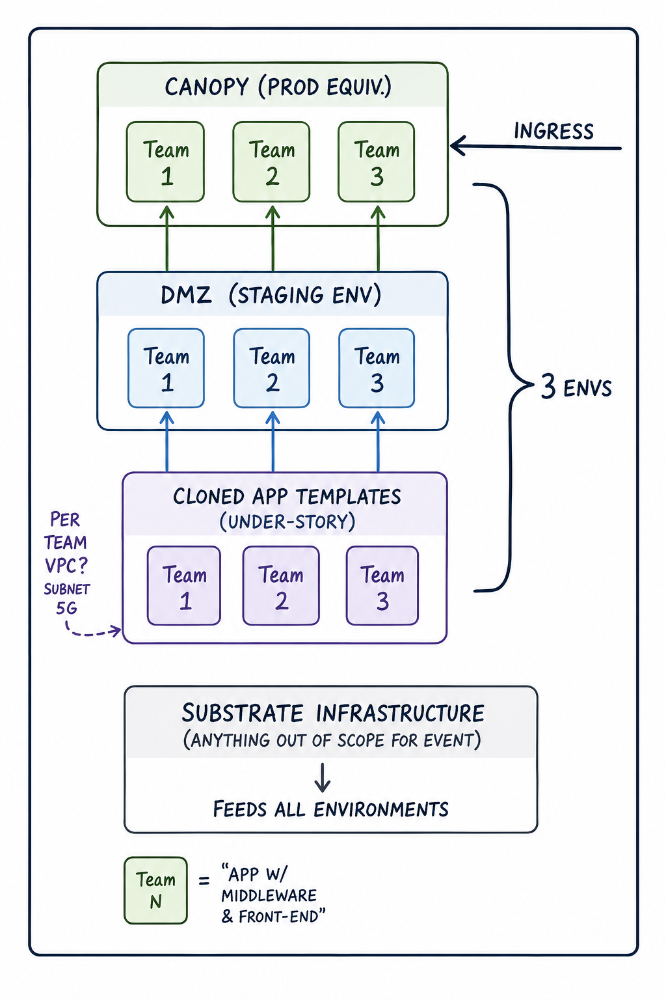

# Per-team environments

How a single Jungl3 install lays out environments **per hackathon team**, on top of a single shared Substrate. Read [`./system-context.md`](./system-context.md) first; this doc zooms into one part of that diagram.

## Diagram

Hand-drawn working diagram (2026-04-25). Mermaid version deferred — the shape is still settling and the hand-drawn version reads better at this stage. Will convert when the per-team isolation model lands ([open question](#open-questions) below).

## Reading the diagram

For a single install with N teams (the diagram shows N=3):

- **Substrate Infrastructure** — single shared layer at the bottom. "Anything out of scope for the event." Networking, identity, the Control Plane, the customer-OpenClaw, observability primitives. Vended once at install time, not per-team. See [ADR 0003](../decisions/0003-installable-via-aws-marketplace.md).
- **Cloned app templates (Understory)** — N team-slices. Every team gets an **identical clone** of a templated app at t=0. This is what the team shapes; what they *can* shape is role-gated (admin can subtract core; team can shape only above the floor admin sets — see [Q-D in the hypothesis revision §4](../reviews/2026-04-25-product-hypothesis-revision.md#4-new-questions-opened)).
- **DMZ (staging env)** — N team-slices. Each team's Understory deploys *up* to its own DMZ. AI personas exercise the prototype here from t=0 ([Input 6 in the hypothesis revision](../reviews/2026-04-25-product-hypothesis-revision.md#input-6--identical-v01-prototype-continuously-graded)). No human ingress — DMZ is AI-only by definition ([ADR 0011](../decisions/0011-canopy-and-ai-first-dmz.md)).
- **Canopy (prod equiv.)** — N team-slices. A team's prototype that crosses the promotion threshold is *promoted up* from its DMZ to its Canopy. Human ingress (judges, beta users, other teams browsing the [Gallery](../glossary.md#gallery)) lands here.

The brace on the right of the diagram covers the three upper layers — Understory, DMZ, Canopy — and labels them "3 envs". So **per team there are three environments**, all sitting on the one shared Substrate.

## What's new vs. `system-context.md`

`system-context.md` shows the layer model for one Jungle/DMZ/Canopy stack, with Substrate underneath and the Control Plane vending the upper layers. It does not draw the **per-team multiplication** — it shows one of each. This diagram does. Two specific clarifications come out of that:

1. **Three environments per team, not three environments per install.** Every layer above Substrate exists N times where N = number of teams. Substrate is the only shared layer.
2. **Understory = "cloned app templates."** Mechanism-named: every team starts from an identical clone. Combined with the "Substrate = anything out of scope for event" framing, this draws a sharper Substrate/Understory boundary than [`../glossary.md`](../glossary.md) currently does. Substrate is the immutable shared baseline; Understory is the team-customizable cloned starting point.

These don't contradict `system-context.md` — they extend it. The system-context diagram describes the *layer model*; this diagram describes the *per-team replication of that layer model*.

## What this diagram deliberately omits

- **The customer-OpenClaw.** It lives in Substrate alongside the Control Plane (see [the hypothesis revision §2](../reviews/2026-04-25-product-hypothesis-revision.md#openclaw)) and operates *across* every team's DMZ. Not drawn here because it's an install-level actor, not a per-team layer. A separate diagram earns its place when the customer-OpenClaw's responsibilities are pinned in an ADR.
- **Crit.** The per-install agent gossip surface ([Q-J' in the hypothesis revision](../reviews/2026-04-25-product-hypothesis-revision.md#4-new-questions-opened)) sits adjacent to or above Canopy. Not drawn until its placement is decided.
- **Per-team network isolation.** "Per team VPC? Subnet 5G" annotation in the diagram is an open question, see below.
- **Promotion gate mechanics.** Arrows up from DMZ → Canopy show *that* promotion happens, not *how* the threshold is computed. See [`§11 #25`](../../CLAUDE.md) and [`#29`](../../CLAUDE.md).
- **The Control Plane.** Folded into Substrate for compactness. `system-context.md` draws it explicitly.

## Open questions

- **Per-team isolation model.** Diagram annotation "Per team VPC? Subnet 5G" — the network/identity isolation shape across the three per-team environments is not decided. Folds into `CLAUDE.md §11 #10` (Canopy AWS topology), `#27` (DMZ AWS topology), and adds a third axis: Understory topology. All three layers per team probably share an isolation model; that model is open.
- **Substrate vs. Understory boundary in P&C v1.** What concretely lives in Substrate (auth, observability, the customer-OpenClaw) vs. what lives in the cloned Understory templates (the claims app, its workflow, its synthetic data). Becomes material when the v1 domain anchor ([ADR 0006](../decisions/0006-v1-domain-anchor-insurance-claims.md)) gets its first concrete CDK app.
- **No per-team Agent Layer.** The customer-OpenClaw critiques every team's DMZ from the install level. There is no separate agent runtime *inside* each team's stack. This shrinks [ADR 0002](../decisions/0002-sub-agent-response-contract.md)'s Agent Layer scope materially; whether ADR 0002's contract still applies (as a convention the customer-OpenClaw enforces) or is superseded is itself open. See [Q-E in the hypothesis revision §4](../reviews/2026-04-25-product-hypothesis-revision.md#4-new-questions-opened).

## Related

- [`./system-context.md`](./system-context.md) — the install-level layer model. Read first.
- [`./dmz.md`](./dmz.md) — DMZ definition and AI-only posture.
- [`./canopy.md`](./canopy.md) — Canopy definition and human-exposure posture.
- [`../glossary.md`](../glossary.md) — Substrate, Understory, Jungle, DMZ, Canopy, Gallery.
- [`../decisions/0011-canopy-and-ai-first-dmz.md`](../decisions/0011-canopy-and-ai-first-dmz.md) — DMZ/Canopy split.
- [`../reviews/2026-04-25-product-hypothesis-revision.md`](../reviews/2026-04-25-product-hypothesis-revision.md) — the revision this diagram crystallizes (Inputs 3, 6, 7).
- [`../research/deep-research-2026-04-25/ecosystem-synthesis.md`](../research/deep-research-2026-04-25/ecosystem-synthesis.md) — why no per-team agent runtime; OpenClaw is install-level.
- [`../../CLAUDE.md`](../../CLAUDE.md) §11 — open decisions, especially #10, #25, #27, #29.
