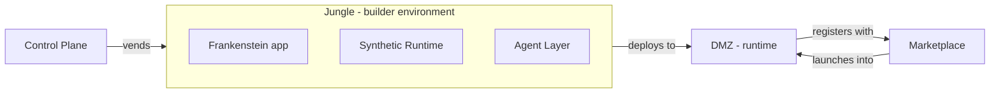

# System Context

The layer model for Jungle3. This is the diagram everything else references.

For term definitions see [`../glossary.md`](../glossary.md).

## Layer diagram

## Reading the diagram

- **Control Plane** sits outside any Jungle. It is the orchestration brain; it *vends* Jungles (and their matching DMZs) on demand.
- A **Jungle** is a composite: a [Frankenstein app](../glossary.md#frankenstein-app) that runs on top of a Synthetic Runtime, with an Agent Layer operating within it. These three are not separate deployables — they are layers of one environment.
- The **DMZ** is a separate, externally accessible runtime. A prototype built in a Jungle *deploys to* its DMZ. The Jungle and DMZ have distinct isolation boundaries (the Jungle may be shared-ish; the DMZ is the public-facing surface and is tightly controlled).
- The **Marketplace** is the shared front door. A DMZ *registers with* the Marketplace once its prototype implements the [Integration Contract](../glossary.md#integration-contract). Users and judges then *launch into* a DMZ from the Marketplace.

## What the diagram deliberately omits

- **Actors** (team builder, judge, beta user, operator). These enter at different points and deserve their own diagram when we document flows. Not here.
- **AWS topology** (accounts, VPCs, ECS, ALB, WAF). Deployment topology is a separate concern and gets its own doc when we commit to it. See `CLAUDE.md` §9 for what's still undecided there.
- **Agent specialists** (Data, API, Event, Auth, etc.). The Agent Layer is shown as a single block. A dedicated agent-architecture diagram earns its place the first time we implement a sub-agent.
- **Synthetic Runtime internals** (generators, emitters, stubs). Same reasoning — diagram when we build, not before.

Splitting those concerns into their own focused diagrams is the point. One crowded diagram is worse than five small ones.

## What is deliberately implied, not stated

- Jungles and DMZs are **ephemeral**. The diagram shows the steady-state relationship; the lifecycle (provision → live → expire → teardown) is a flow diagram for a different doc.
- The Control Plane also handles Marketplace registration plumbing, DNS, and lifecycle — not just initial vending. This will be expanded the first time we document the Control Plane in its own file.

## Related

- [`../glossary.md`](../glossary.md) — term definitions
- [`../decisions/`](../decisions/) — architectural decisions that shape or constrain this model
- `../../CLAUDE.md` — repo-level guidance, Lovable boundary, AWS rules, open decisions
