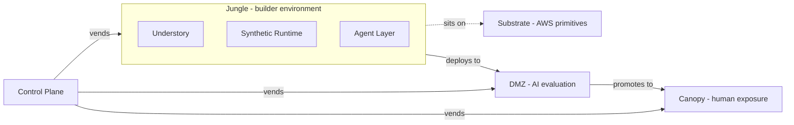

# System Context

The layer model for Jungl3. This is the diagram everything else references.

For term definitions see [`../glossary.md`](../glossary.md).

## Layer diagram

All of the above lives inside a single customer's AWS account, installed from the Jungl3 AWS Marketplace listing. See [ADR 0003](../decisions/0003-installable-via-aws-marketplace.md). The DMZ/Canopy split is pinned in [ADR 0011](../decisions/0011-canopy-and-ai-first-dmz.md).

## Reading the diagram

- **Control Plane** sits outside any Jungle. It is the orchestration brain; it *vends* Jungles, DMZs, and Canopies on demand. It runs inside the customer's AWS account, not as a Jungl3-hosted service.
- **Substrate** is the AWS primitives layer the whole install sits on — networking, identity, storage, compute, observability. Vended implicitly by the CloudFormation install, not per-Jungle. Named here because procurement cares: Substrate is *what the customer's platform team operates*.
- A **Jungle** is a composite: an [Understory](../glossary.md#understory) that runs on top of a Synthetic Runtime, with an Agent Layer operating within it. These three are not separate deployables — they are layers of one environment. The Jungle as a whole sits on the Substrate.
- The **DMZ** is the AI evaluation surface. A prototype built in a Jungle *deploys to* its DMZ first. Inside the DMZ, AI agents (personas, pressure testers, chaos monkeys, focus-group facsimiles) exercise the prototype. Humans do not enter the DMZ. See [`./dmz.md`](./dmz.md).
- The **Canopy** is the human exposure surface. A prototype that passes its DMZ evaluation is *promoted to* the Canopy, where judges, beta users, and other invited outsiders find, try, and judge it. The [Gallery](../glossary.md#gallery) — the listing/discovery UI — lives inside the Canopy. See [`./canopy.md`](./canopy.md).
- The DMZ, the Canopy, and the Jungle are three distinct isolation boundaries with three distinct users and three distinct risk profiles. All three live inside the customer's AWS account. The DMZ/Canopy split supersedes the single-exposure-surface framing from [ADR 0004](../decisions/0004-canonical-platform-vocabulary.md); see [ADR 0011](../decisions/0011-canopy-and-ai-first-dmz.md).

## What the diagram deliberately omits

- **Actors** (team builder, judge, beta user, operator). These enter at different points and deserve their own diagram when we document flows. Not here.
- **AWS topology** (accounts, VPCs, ECS, ALB, WAF). Deployment topology is a separate concern and gets its own doc when we commit to it. See `CLAUDE.md` §11 for what's still undecided there.
- **Agent specialists** (Data, API, Event, Auth, etc.). The Agent Layer is shown as a single block. A dedicated agent-architecture diagram earns its place the first time we implement a sub-agent.
- **Synthetic Runtime internals** (generators, emitters, stubs). Same reasoning — diagram when we build, not before.
- **Understory service decomposition.** The `Understory` block in the diagram is a single layer; what the Understory is *made of* (services, modules, tables) is a separate concern. [`../research/research2-v1-service-build-plan.md`](../research/research2-v1-service-build-plan.md) proposes one such decomposition (ten services anchored on a Work Item / Case). Whether Jungl3 adopts that decomposition is open — see [`../../CLAUDE.md`](../../CLAUDE.md) §11.
- **Substrate internals.** Substrate is shown as a single block; which AWS services it comprises (VPC shape, compute choice, storage, identity) is deliberately undecided here. See [`../../CLAUDE.md`](../../CLAUDE.md) §11.

Splitting those concerns into their own focused diagrams is the point. One crowded diagram is worse than five small ones.

## What is deliberately implied, not stated

- Jungles, DMZs, and Canopies are **ephemeral**. The diagram shows the steady-state relationship; the lifecycle (provision → live → expire → teardown) is a flow diagram for a different doc.
- The Control Plane also handles Gallery-registration plumbing inside a Canopy, DNS within the install's scope, and lifecycle — not just initial vending. This will be expanded the first time we document the Control Plane in its own file.
- The **promotion gate** between DMZ and Canopy — what it means for a prototype to "pass" evaluation — is decided as a concept ([ADR 0011](../decisions/0011-canopy-and-ai-first-dmz.md)) but not yet specified. See [`../../CLAUDE.md`](../../CLAUDE.md) §11.

## Related

- [`../glossary.md`](../glossary.md) — term definitions
- [`../decisions/`](../decisions/) — architectural decisions that shape or constrain this model
- `../../CLAUDE.md` — repo-level guidance, Lovable boundary, AWS rules, open decisions
