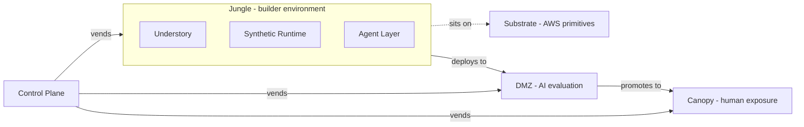

# Jungl3 — end-to-end overview

A single-file reading path for the whole platform. What Jungl3 is, the shape it takes, how customers and teams use it, how the current architecture came to be, what we're building next, and what's still open.

**This doc is a map, not a source of truth.** Every concrete claim here has a canonical home elsewhere in the repo and links to it. If something reads as fact without a link, that's a bug — either the claim is unsourced (flag it) or the canonical doc is missing (write it there, not here).

**How to use it.** Read top-to-bottom the first time. After that, jump to the section you need. Each section is self-contained enough that out-of-order reading mostly works.

**Audience.** A new contributor, a curious collaborator, a future agent starting cold, or me in three weeks. Not investors — they should read [`decisions/STATUS.md`](./decisions/STATUS.md).

---

## Contents

- [1. What Jungl3 is](#1-what-jungl3-is)
- [2. Why it exists](#2-why-it-exists)
- [3. Shape at a glance](#3-shape-at-a-glance)
- [4. The customer's story](#4-the-customers-story)
- [5. The builder's story](#5-the-builders-story)
- [6. How we got here](#6-how-we-got-here)
- [7. Current phase — v0.1](#7-current-phase--v01)
- [8. What's still open](#8-whats-still-open)
- [9. Repo map](#9-repo-map)
- [10. Where to go next](#10-where-to-go-next)

---

## 1. What Jungl3 is

Jungl3 is an **AI-native prototype platform for time-boxed innovation sprints**. One-line summary from [`../CLAUDE.md`](../CLAUDE.md) §1:

> Jungl3 is distributed as an AWS Marketplace listing; once installed in a customer's AWS account, an in-account Control Plane vends isolated "Jungles" (builder environments that are alive on day one, built on an [Understory](./glossary.md#understory) of pre-wired application baseline). A prototype deploys from its Jungle to its [DMZ](./glossary.md#dmz) — a private, AI-first evaluation environment where agents probe it — and is then promoted to its [Canopy](./glossary.md#canopy), the human exposure surface where judges, beta users, and other outsiders find, try, and judge it through the [Gallery](./glossary.md#gallery).

Everything inside a customer's install stays inside their AWS account. Jungl3 the company does not run a hosted multi-tenant platform; see [ADR 0003](./decisions/0003-installable-via-aws-marketplace.md).

**Terms.** [`glossary.md`](./glossary.md) is canonical. The recurring terms you'll see everywhere: [Jungle](./glossary.md#jungle), [Understory](./glossary.md#understory), [DMZ](./glossary.md#dmz), [Canopy](./glossary.md#canopy), [Gallery](./glossary.md#gallery), [Control Plane](./glossary.md#control-plane), [Substrate](./glossary.md#substrate), [Synthetic Runtime](./glossary.md#synthetic-runtime), [Agent Layer](./glossary.md#agent-layer), [Integration Contract](./glossary.md#integration-contract).

---

## 2. Why it exists

The traditional motion to prototype something is **additive from zero**: idea → design → scaffold → wire infra → connect services → deploy → test → iterate. Weeks of pre-product work before the first real user interaction.

Jungl3's motion is **shape a living baseline**: idea → vend a living system → trim, substitute, and extend → test → iterate. Teams don't start from a blank page; they start from an [Understory](./glossary.md#understory) that's already deployed, integrated, emitting, and rendering on day one. Their job is to reshape it into the prototype they intend. Subtraction is a primary motion, not the only one.

The full framing — who it's for, what it replaces, what the platform optimizes for, the trade-off teams accept — is in [`product/positioning.md`](./product/positioning.md).

The **deeper problem** the platform is actually solving: [plausibility collapse](./research/findings.md) — the moment a curious person realizes they're looking at a toy. A synthetic world with enough regulated-domain realism to survive thirty seconds of adult scrutiny is a narrower and sharper claim than "faster scaffolding." The [2026-04-24 viability review](./reviews/2026-04-24-viability-review.md) argues this is the real wedge.

---

## 3. Shape at a glance

The layer model, inlined from [`architecture/system-context.md`](./architecture/system-context.md) (canonical home):

Everything above lives inside a single customer's AWS account.

**Reading the layers:**

- **[Control Plane](./glossary.md#control-plane)** — in-account orchestration; vends Jungles, DMZs, and Canopies on demand. Not a Jungl3-hosted service.
- **[Substrate](./glossary.md#substrate)** — AWS primitives (networking, identity, storage, compute, observability) the install sits on. Provisioned once, by the CloudFormation install.
- **[Jungle](./glossary.md#jungle)** — a team's builder environment. Holds an [Understory](./glossary.md#understory) (live application baseline), a [Synthetic Runtime](./glossary.md#synthetic-runtime) (fake-but-believable data + events + stubs), and an [Agent Layer](./glossary.md#agent-layer) (AI specialists that inspect and modify). These are layers of one environment, not separate deployables.
- **[DMZ](./glossary.md#dmz)** — AI-first evaluation surface. Private, no human traffic. AI agents (personas, fuzzers, pressure testers) probe a prototype here before any human sees it. See [`architecture/dmz.md`](./architecture/dmz.md).
- **[Canopy](./glossary.md#canopy)** — human exposure surface. Judges, beta users, stakeholders find, try, and judge prototypes here through the [Gallery](./glossary.md#gallery). See [`architecture/canopy.md`](./architecture/canopy.md).

The DMZ/Canopy split — two surfaces, sequenced — is the central architectural move and is pinned in [ADR 0011](./decisions/0011-canopy-and-ai-first-dmz.md). Before 2026-04-22 the DMZ was a single human+AI surface; that framing is superseded. Captures older than that date use "DMZ" to mean what Canopy means now (see [`glossary.md#dmz`](./glossary.md#dmz)).

**What the diagram deliberately omits:** actor flows, AWS topology (VPC, ALB, WAF — all undecided), Agent Layer specialist breakdown, Synthetic Runtime internals, Understory service decomposition. Those are separate concerns with their own diagrams when they earn their place.

---

## 4. The customer's story

A compressed walk-through of the customer lifecycle, under current architectural decisions. Not a technical spec; a narrative to anchor the rest of this doc.

1. **Discover.** A customer (most plausibly a P&C insurance innovation lead; see ICP discussion in [viability review §1](./reviews/2026-04-24-viability-review.md)) encounters Jungl3 on AWS Marketplace.
2. **Subscribe.** They subscribe through Marketplace. Billing flows through AWS, not Jungl3.
3. **Install.** They launch the Jungl3 CloudFormation template into their own AWS account. This stands up Substrate + Control Plane. `[Unverified]` which IaC authoring tool produces that template — see [`../CLAUDE.md`](../CLAUDE.md) §11 #7.
4. **Operate.** They run their own Jungl3 instance. Control Plane + Jungles + DMZs + Canopies all live inside their account, vended on demand. Jungl3 the company does not have credentials into their account and does not operate anything there. See [ADR 0003](./decisions/0003-installable-via-aws-marketplace.md).
5. **Vend a Jungle.** For a given sprint, the customer's operator (or each team lead) uses the Control Plane CLI to vend a Jungle. The Jungle comes up alive: Understory deployed, Synthetic Runtime producing events, Agent Layer reachable, seed data loaded.
6. **Sprint.** Teams shape their Jungles into prototypes. (See §5.)
7. **Promote to DMZ.** When a prototype is ready for evaluation, it deploys from its Jungle into its DMZ. AI agents probe it — personas, pressure testers, chaos monkeys, focus-group facsimiles. Humans do not enter the DMZ.
8. **Promote to Canopy.** Once a prototype passes its DMZ evaluation gate (`[Unverified]` what "pass" means — see [`../CLAUDE.md`](../CLAUDE.md) §11 #25, #29), it is promoted to the Canopy. The Canopy is the human exposure surface. Judges and beta users find prototypes through the Gallery and interact with them there.
9. **Judge.** Judging is *interaction*, not slide decks. Judges receive personas, attempt specific tasks inside each prototype's Canopy, and score based on what they actually experienced. See [`product/judging.md`](./product/judging.md).
10. **Teardown.** Jungles, DMZs, and Canopies are **ephemeral by default** ([`glossary.md#sprint--event`](./glossary.md#sprint--event)). A Reaper destroys them on the sprint's schedule. Retention past the sprint is explicit opt-in. See [ADR 0010](./decisions/0010-seeder-and-reaper-patterns.md) for the install-and-teardown pattern.

**What's deliberately absent from this narrative:** Jungl3 as a vendor running anything for the customer. There is no SaaS control plane, no shared tenancy, no cross-install data flow. The install is the customer's.

---

## 5. The builder's story

What a team (and its AI agents) actually does inside a freshly vended Jungle. Also compressed; this is the story that `product/positioning.md` tells at length.

1. **Open the Jungle.** The team logs into their Jungle. An Understory is already running — a complete application baseline with real users, real data, real events, realistic integrations. Most likely a P&C-claims-shaped Understory per [ADR 0006](./decisions/0006-v1-domain-anchor-insurance-claims.md); in v1 this may generalize via [Domain Starters](./glossary.md#domain-starter).
2. **Shape, don't scaffold.** The team's first action is an *edit*, not a scaffolding task. They cut what doesn't belong, substitute what does, and extend where the baseline stops. Subtraction is the primary motion. See [`product/positioning.md`](./product/positioning.md).
3. **Use the Agent Layer.** The Jungle ships with [inspection specialists](./glossary.md#agent-layer) — one each for Data, API, Event, Auth, Environment, Listing. A builder asks "why is this broken" and a specialist returns structured `{status, summary, evidence, recommended_action}` evidence grounded in a real inspection surface ([ADR 0002](./decisions/0002-sub-agent-response-contract.md)). Specialists are not prompt-memory oracles; they are attached to live system state.
4. **Stay within the Synthetic Runtime.** Data is synthetic or explicitly-scrubbed ([`glossary.md#synthetic-runtime`](./glossary.md#synthetic-runtime)). Events carry a CloudEvents v1.0 envelope with `{trace_id, case_id}` dual correlation ([ADR 0005](./decisions/0005-event-envelope-and-correlation-identifiers.md)). Multi-step business processes are Step Functions state machines ([ADR 0008](./decisions/0008-workflows-are-state-machines.md)). The audit trail is append-only and hash-chained ([ADR 0009](./decisions/0009-audit-trail-is-append-only-hash-chained.md)). These are not things the team builds; they're what the Understory already provides.
5. **Implement the Integration Contract.** For the prototype to auto-register into its Gallery tile, it implements a small set of endpoints (`/metadata`, `/health`, `/launch-config`, optional `/demo-reset` and `/events`). See [`glossary.md#integration-contract`](./glossary.md#integration-contract).
6. **Promote.** When ready, the team promotes from Jungle → DMZ. AI evaluation runs. If it passes, promotion to Canopy is available. See §4.
7. **Observe costs.** Jungl3 targets **$100/month infra + $50/month metered LLM** per install ([ADR 0007](./decisions/0007-v1-cost-profile-and-llm-metering.md)). LLM use is metered through a gateway with pre-estimation, debit, and reconcile. Hitting the LLM cap hard-cuts with graceful degradation.

---

## 6. How we got here

A compressed arc. Fuller retelling in the [viability review](./reviews/2026-04-24-viability-review.md) and [ADR 0003 context](./decisions/0003-installable-via-aws-marketplace.md).

**Origin.** `doc.md` and `doc2.md` (repo root, unchanged source material) laid out the original vision — an AI-native sprint platform with a single exposure surface called the DMZ. That framing assumed **Jungl3 as hosted multi-tenant SaaS**.

**Installable pivot ([ADR 0003](./decisions/0003-installable-via-aws-marketplace.md), 2026-04-21).** Third-party analysis — later archived to [`research-archive/first-generation/research1-aws-installable-shape.md`](./research-archive/first-generation/research1-aws-installable-shape.md) — argued the delivery model should instead be an AWS Marketplace listing installed into each customer's AWS account. Cascading consequences for tenancy, control-plane location, data-classification enforceability, and the identity of the user. ADR 0003 accepted the pivot. The entire repo's framing (glossary, architecture, `CLAUDE.md`) was rewritten against the installable model.

**Vocabulary lock ([ADR 0004](./decisions/0004-canonical-platform-vocabulary.md)).** The "Frankenstein app" became the [Understory](./glossary.md#understory); the AWS primitives layer became the [Substrate](./glossary.md#substrate); "Gallery" was briefly retired and absorbed into the DMZ. All redefinitions captured; frozen research files were not rewritten, and readers substitute mentally.

**Deep research sweeps (2026-04-21 and 2026-04-22).** Two commissioned Parallel.ai clusters produced 22 reports on synthetic-enterprise realism, v1 domain anchor options, minimum viable realism floors, synthetic data generation, event/workflow patterns, stubs, packaging, cost floor, observability, personas, regulated cues, and extension models. The synthesis layer (`docs/research/*/SYNTHESIS.md`, `findings.md`, per-cluster `CANDIDATES.md` / `RISKS.md`) is the working read of that material; raw reports are archived in [`research-archive/`](./research-archive/).

**ADRs 0005–0010 (2026-04-21/22).** Six architectural ADRs were accepted in close succession, each landing a specific implementation shape that the research surfaced: event envelope, v1 domain (P&C claims), cost profile + LLM metering, workflows-as-state-machines, hash-chained audit trail, Seeder/Reaper patterns. See [`decisions/STATUS.md`](./decisions/STATUS.md) for the one-page view.

**DMZ/Canopy split ([ADR 0011](./decisions/0011-canopy-and-ai-first-dmz.md), 2026-04-22).** The biggest post-origin architectural move. The single "DMZ" (which was shared between AI probing and human judging) was split into **DMZ (AI evaluation, private)** and **Canopy (human exposure, public-ish)**, sequenced DMZ-then-Canopy. Prompt-injection containment, credential isolation, and tool-use scoping got a hardened boundary; human-facing prototypes got a dedicated surface with real analytics, auth, and feedback capture. The Gallery returned, scoped as a sub-concept of the Canopy.

**Sideband research + user memos (2026-04-22, 2026-04-24).** A sideband cluster (IDPs, multi-agent frameworks, synthetic-data vendors, ideation bazaars, chaos engineering) validated the "novel category" framing — no single vendor ships the Jungl3 bundle. Four user-dropped memos on 2026-04-24 added sharper AWS Marketplace seller mechanics (FTR, Vendor Insights, co-sell) as `CLAUDE.md §11` items #35–#37.

**Viability review + research freeze (2026-04-24).** The [viability review](./reviews/2026-04-24-viability-review.md) named the central execution risk: **a solo founder with no first customer**, building against v1 scope. The [research-sufficiency note](./reviews/2026-04-24-research-sufficiency.md) argued the repo was over-researched for its build state; the next unblock was human action, not reading. The [v0.5 wedge ADR 0012](./decisions/0012-v0.5-wedge-scope.md) (Proposed) scoped a deliberately reduced first-shipped form. The [v0.1 plan](./reviews/2026-04-24-v0.1-plan.md) followed, defining the skeleton build that comes before v0.5. Research was marked frozen; raw inputs were archived to `research-archive/`.

**Where we are now.** Phase 0 (v0.1 skeleton) — see §7.

---

## 7. Current phase — v0.1

Canonical home: [`reviews/2026-04-24-v0.1-plan.md`](./reviews/2026-04-24-v0.1-plan.md). Read that doc; this section is a pointer.

**Scope.** A **"promotable tiny claims Understory"** at todo-app complexity: one entity (`Claim`), one three-state workflow (submit → assign → approve/deny), one seeded persona, ~12 seeded records, shipped as a vendable + reapable Jungle running in a dev AWS account.

**What v0.1 proves:** vend flow, Understory alive on day one, teardown flow, deterministic seeding, Integration Contract first shape, structured observability. **What v0.1 does NOT prove:** maker-checker, LLM cost discipline, DMZ agent probing, Canopy/Gallery/Inspection surfaces, Marketplace submission, upgrade safety. v0.1 proves the scaffolding, not the product thesis. v0.5 is where the thesis gets tested.

**Why a "tiny claims" overlay on a domain-neutral primitive.** ADRs 0006 and 0012 pin P&C claims as the v1 domain; skipping it in v0.1 would create an odd gap. But v0.1's primitives (Control Plane vends, Understory alive, Integration Contract honored, install+teardown) are domain-neutral — if the first real customer is not P&C, only the overlay changes.

**Parallel tracks.** Three tracks run simultaneously: **A** design-partner outreach (the #1 unblock per the viability review), **B** architecture-hardening passes (MVR floor, IaC tool pick, Control Plane runtime pick, LLM cost empirical study), **C** v0.1 skeleton build. Stop-the-world triggers are listed in the plan — the biggest is "a design-partner call gets booked," which pauses C to prep for the call.

**What happens after v0.1.** v0.5 per [ADR 0012](./decisions/0012-v0.5-wedge-scope.md) — a deliberately reduced first shipped form for a named design partner. Then v1 — the full architecture the current ADRs describe.

---

## 8. What's still open

Canonical home: [`../CLAUDE.md`](../CLAUDE.md) §11. One-page investor view: [`decisions/STATUS.md`](./decisions/STATUS.md).

The open decisions cluster into four groups:

**Marketplace listing mechanics.** Pricing model (#1), stack structure (#2), the genuinely hard upgrade/update problem (#3), minimum IAM permissions (#4), supported regions (#5), account scenarios (#6), IaC authoring tool (#7), listing CI/CD (#8), solo-support operating model (#34), FTR/"Deployed on AWS" posture (#35), Vendor Insights (#36), co-sell/ACE/MDF (#37). Most of these become concrete when the Marketplace listing build starts; #35–#37 are blocked on #31 (first design partner).

**In-install operation.** Canopy authentication (#9), Canopy AWS topology (#10), Control Plane runtime (#11), prototype lifespan (#12), Canopy telemetry (#13), data classification rules (#14), cross-install discoverability (#15 — default: no), canonical maker-checker workflow for v1 (#16), realism threshold (#17), LLM budget enforcement details (#18), state-aware SLA timers (#22), mid-execution budget-exhaustion signaling (#23), SME exemplar commission timing (#24).

**DMZ / Canopy (opened by [ADR 0011](./decisions/0011-canopy-and-ai-first-dmz.md)).** Promotion gate shape (#25), DMZ agent runtime choice (#26), DMZ AWS topology (#27), synthetic-user-tester placement (#28), promotion criteria (#29), persona schema alignment (#30).

**Strategic / product.** Kiro CLI vs custom CLI (#20), first-sponsor context (#21), **first design-partner acquisition path (#31) — "the single most concerning item in the repo" per the viability review**, v0.5 scope vs v1 scope (#32 — draft resolution in ADR 0012), ICP narrowing (#33 — held pending #31).

**The load-bearing open questions for near-term work:**

- **#31 (first design partner).** Until this shows concrete progress, everything else downstream (v0.5 build authorization, ICP narrowing, Marketplace publication, co-sell) is speculative.
- **#7 (IaC tool).** Unblocks v0.1 Track C.
- **#11 (Control Plane runtime).** v0.1's vend/reap Lambdas are themselves the test.
- **#3 (upgrade strategy).** The genuinely hard problem. Not touched by v0.1 on purpose; will force design work before the first Marketplace version ships.

---

## 9. Repo map

A one-paragraph-per-area view. Fuller structure rules live in [`../CLAUDE.md`](../CLAUDE.md) §4.

**Repo root.** The **AWS Marketplace listing landing page** — a TanStack Start + React 19 + Tailwind v4 + shadcn/ui app scaffolded by [Lovable.dev](https://lovable.dev), deploying to Cloudflare Workers. This is Lovable's territory; hands-off per [`../CLAUDE.md`](../CLAUDE.md) §3. It is **not** a Jungl3 instance — a Jungl3 instance runs in a customer's AWS account. Lovable commits directly to `main` autonomously; our work lives in subdirs to avoid merge conflicts with it.

**`docs/`.** This directory. Canonical docs. Not Lovable's territory. Sub-layout:
- [`docs/glossary.md`](./glossary.md) — term definitions. Single source of truth.
- [`docs/architecture/`](./architecture/) — how the system is structured. Currently: [`system-context.md`](./architecture/system-context.md), [`agent-layer.md`](./architecture/agent-layer.md), [`dmz.md`](./architecture/dmz.md), [`canopy.md`](./architecture/canopy.md).
- [`docs/decisions/`](./decisions/) — ADRs (Nygard-trimmed format). 11 accepted, 1 Proposed. One-page status view: [`STATUS.md`](./decisions/STATUS.md); full backlog: [`BACKLOG.md`](./decisions/BACKLOG.md).
- [`docs/product/`](./product/) — product framing. [`positioning.md`](./product/positioning.md), [`judging.md`](./product/judging.md).
- [`docs/research/`](./research/) — **active** synthesis layer. [`findings.md`](./research/findings.md), per-cluster `SYNTHESIS.md` / `CANDIDATES.md` / `RISKS.md`, and the still-load-bearing [`synthetic-user-testing/`](./research/synthetic-user-testing/) cluster.
- [`docs/research-archive/`](./research-archive/) — **frozen** raw research inputs. Absorbed into ADRs 0001–0012 and `CLAUDE.md §11`. Symlinks keep synthesis-to-raw-report links resolving. See [`research-archive/README.md`](./research-archive/README.md).
- [`docs/reviews/`](./reviews/) — opinion/plan docs that aren't policy. [`2026-04-24-viability-review.md`](./reviews/2026-04-24-viability-review.md), [`2026-04-24-research-sufficiency.md`](./reviews/2026-04-24-research-sufficiency.md), [`2026-04-24-v0.1-plan.md`](./reviews/2026-04-24-v0.1-plan.md).
- [`docs/visuals/`](./visuals/) — diagram style + assets.

**`.cursor/skills/`.** Repo-specific skills for the agent. Currently: `adr-author`, `architecture-note-synthesis`. See [`.cursor/skills/README.md`](../.cursor/skills/README.md).

**Platform domain subdirs** (don't exist yet; created on first real use per [`../CLAUDE.md`](../CLAUDE.md) §4): `marketplace-listing/`, `control-plane/`, `dmz/`, `canopy/`, `synthetic-runtime/`, `agents/`, `cli/`, `contracts/`. Each will carry its own `README.md`, dependency manifest, and can be built/tested/deployed independently.

**`doc.md`, `doc2.md`.** The original product vision. Retained unchanged as historical source. Carries frontmatter noting the installable pivot. Read as design transcript, not current architecture.

**`CLAUDE.md`.** Repo policy for agents. §0 current phase, §1 what Jungl3 is, §3 the Lovable boundary, §4 domain-subdir rules, §5 AWS rules, §7 information placement, §10 skills, §11 open decisions.

---

## 10. Where to go next

Pick a role:

**"I'm a new contributor."** Read this doc top-to-bottom (you just did). Then [`../CLAUDE.md`](../CLAUDE.md) for the repo policy that governs what you do. Then the section of [`docs/`](./) that touches what you're about to change.

**"I'm an agent starting cold."** Read [`../CLAUDE.md`](../CLAUDE.md) first — it has the blocking rules (Lovable boundary, AWS profile + read-only, information placement, no-fallbacks). Then this doc. Then check [`.cursor/skills/`](../.cursor/skills/) for anything relevant to the task.

**"I want to understand the product pitch."** [`product/positioning.md`](./product/positioning.md), then [`reviews/2026-04-24-viability-review.md`](./reviews/2026-04-24-viability-review.md) for the honest read of it.

**"I want to understand the architecture."** [`architecture/system-context.md`](./architecture/system-context.md), then [`architecture/dmz.md`](./architecture/dmz.md) and [`architecture/canopy.md`](./architecture/canopy.md), then [`architecture/agent-layer.md`](./architecture/agent-layer.md), then scan [`decisions/STATUS.md`](./decisions/STATUS.md) for what's been pinned.

**"I want to know what's been decided."** [`decisions/STATUS.md`](./decisions/STATUS.md) is the one-page view. [`decisions/README.md`](./decisions/README.md) has the full index.

**"I want to know what's still open."** [`../CLAUDE.md`](../CLAUDE.md) §11. [`decisions/BACKLOG.md`](./decisions/BACKLOG.md) for candidate ADRs with drafting order.

**"I want to understand what's being built now."** [`reviews/2026-04-24-v0.1-plan.md`](./reviews/2026-04-24-v0.1-plan.md).

**"I want the full path from here to v1 as action items."** [`roadmap.md`](./roadmap.md).

**"I need to dig into the research."** Start with [`research/findings.md`](./research/findings.md) (the v1 story) and [`research/README.md`](./research/README.md) (the topic index). Raw inputs are archived in [`research-archive/`](./research-archive/); come back there only when you need the original evidence.

**"I'm writing something new."** [`../CLAUDE.md`](../CLAUDE.md) §7 (information placement) tells you where it goes. The two authoring skills in [`.cursor/skills/`](../.cursor/skills/) — `adr-author` for decisions, `architecture-note-synthesis` for rough-fragment-to-doc routing — exist precisely for this.

---

## Related

- [`../CLAUDE.md`](../CLAUDE.md) — repo policy (read this too; this overview doesn't replace it).
- [`glossary.md`](./glossary.md) — canonical terms.
- [`architecture/system-context.md`](./architecture/system-context.md) — the layer model.
- [`product/positioning.md`](./product/positioning.md) — product framing.
- [`decisions/STATUS.md`](./decisions/STATUS.md) — one-page view of what's decided, next, and open.
- [`reviews/2026-04-24-viability-review.md`](./reviews/2026-04-24-viability-review.md) — the honest external read.
- [`reviews/2026-04-24-v0.1-plan.md`](./reviews/2026-04-24-v0.1-plan.md) — current-phase plan.
