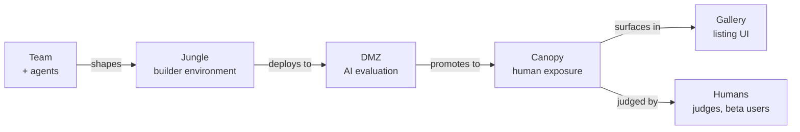

# Where we are

A short read-in for someone who has not spent time in this repo. Not a pitch. Not a roadmap. A grounded sketch of what Jungl3 is, what it isn't yet, and what we're still working out.

Written 2026-04-22.

## What Jungl3 is

Jungl3 is an **AI-native prototype platform for time-boxed innovation sprints** inside enterprises. The shorter form: most enterprise innovation teams cannot move faster than their own IT can provision. Jungl3 gives them a pre-provisioned, already-running application — real data, real users, real events, real audit trail, multiple integrations already wired — that they *shape into* whatever prototype they're trying to build. They are not building *up* from a blank page. They are editing a living thing on day one.

The platform ships as an **AWS Marketplace listing**. A customer subscribes, launches a CloudFormation template into their own AWS account, and from that moment forward operates their own Jungl3 install. Everything — the orchestration brain, the builder environments, the evaluation surfaces — runs inside the customer's account. We don't host a platform; we ship a platform.

## The shape, in one picture

Four surfaces, each with one job:

- **Jungle** — the builder environment. Teams and their AI agents shape the living baseline here.
- **DMZ** — a private, hardened space where **AI agents** probe the prototype first: personas, pressure tests, focus-group facsimiles, chaos monkeys. No humans. The cheap dense stress-test pass before anyone outside sees the thing.
- **Canopy** — the public-ish surface where **humans** meet the prototype: judges, beta users, stakeholders. Inside it, the **Gallery** is where people browse prototypes as tiles.
- Prototypes move through in order. DMZ first. Canopy second.

## Why this is interesting (the bet)

Three things changed at once.

1. **Enterprise innovation is stuck at provisioning.** Internal innovation teams can't get environments fast enough to test ideas. By the time they have something running, the window has closed. This is an old problem. It's also a boring problem — which is why nobody has solved it well.
2. **AI has changed what "starting" means.** An agent can reshape an existing application faster than a human can scaffold a new one. The work has shifted from "build it" to "shape what's already there." That only makes sense if there's already something *there* to shape — which is the Understory layer Jungl3 ships.
3. **Evaluation is now cheap, if you let agents do it.** AI agents can probe a prototype as personas, at a volume and speed a human panel cannot. That means "is this any good?" can be answered with real evidence *before* a human ever looks at it. This is the DMZ's job, and it's the part of the product I think is actually novel.

The bet is that these three land together inside a single product, not as separate tools a company has to stitch up itself. Current research confirms no single vendor ships this bundle — see [`../research/sideband-2026-04-22/SYNTHESIS.md`](../research/sideband-2026-04-22/SYNTHESIS.md) for the landscape scan.

## What's actually decided

We've made 11 architecture decisions so far, each pinned as an ADR. The ones a smart outsider would care about:

- **Packaging model.** Jungl3 ships via AWS Marketplace, installed into the customer's own AWS account. Not a hosted SaaS. This is a pretty opinionated call — it simplifies the security story and the early operations footprint, but it makes upgrades hard. ([ADR 0003](../decisions/0003-installable-via-aws-marketplace.md).)
- **First domain: insurance claims.** Our "Understory" on day one models P&C insurance claims processing — seven services, a regulator-aware workflow, synthetic PII. We picked it because it's *realism per unit of complexity*: dense enough to feel real, bounded enough to build. ([ADR 0006](../decisions/0006-v1-domain-anchor-insurance-claims.md).)
- **Cost posture.** Under $100/month infrastructure per install plus $50/month metered LLM usage, hard cutoff with graceful degradation. A line in the sand that shapes every other decision. ([ADR 0007](../decisions/0007-v1-cost-profile-and-llm-metering.md).)
- **How prototypes move through the system.** DMZ (AI evaluation) → Canopy (human exposure), as described above. ([ADR 0011](../decisions/0011-canopy-and-ai-first-dmz.md).)
- **Agent response contract.** Every inspection agent returns the same structured shape — it's a small discipline, but it keeps the agent layer from degenerating into confident lying. ([ADR 0002](../decisions/0002-sub-agent-response-contract.md).)
- **Audit trail.** Append-only, hash-chained, separate from operational data — because a claims domain demands it, and building it later is harder than building it in. ([ADR 0009](../decisions/0009-audit-trail-is-append-only-hash-chained.md).)
- **Install and teardown patterns.** Async Step Functions seeder, HMAC-deterministic data, a dedicated Reaper for tearing down cleanly. ([ADR 0010](../decisions/0010-seeder-and-reaper-patterns.md).)

The full list: [`../decisions/README.md`](../decisions/README.md). The short "what commits to what" summary: [`../decisions/STATUS.md`](../decisions/STATUS.md).

## What's not decided

There are 20-something open questions. Most fall into three buckets:

- **Things that wait for a first customer.** Pricing model, supported AWS regions, first Domain Starter beyond insurance claims. Not research-gated — context-gated.
- **Things that wait for the first build.** DMZ and Canopy AWS topology, the DMZ → Canopy promotion gate shape, authentication mechanisms, retention tiering. These resolve when we build them.
- **Things that are genuinely load-bearing and open.** The biggest one: how Marketplace upgrades work. Stack updates that don't destroy customer data or orphan resources are the hard problem in this packaging model. We're aware. We haven't solved it.

Full list in [`../../CLAUDE.md`](../../CLAUDE.md) §11.

## What's been researched

Four research clusters, each commissioned by us, totaling about 25 deep-research reports:

- **AWS installable shape** — what an AWS Marketplace-delivered platform actually looks like. Fed ADR 0003.
- **v1 service build plan** — what a first Understory should decompose into. Fed ADR 0006.
- **Regulated-domain plausibility** — what makes a claims-processing simulation credible to a former state regulator. Fed ADRs 0005–0010.
- **Synthetic user testing** — AI agents as seeded personas probing a prototype. Fed ADR 0011.

Index and raw files: [`../research/README.md`](../research/README.md). A consolidated picture of what it all points to: [`../research/findings.md`](../research/findings.md).

## What's next (short honest list)

The next three or four decisions, in likely order:

1. **Retention tiering.** CloudWatch logs pile up and compound the cost ceiling; needs a tiered retention decision. Short ADR, high payoff.
2. **Seed data generation.** Pre-generated synthetic data shipped as an immutable artifact — settles a real cost-and-determinism risk.
3. **Regulatory surface for insurance claims.** State-specific SLA timers, append-only reserve ledgers, segregated SIU data. This is the decision that determines whether a former claims examiner looks at the prototype and says "yes, that's how it works" or not.
4. **Marketplace stack structure.** Single stack or nested optional components. Interacts with pricing.

Beyond that, the first real install into a first real customer account. Everything else sharpens once we're operating rather than designing.

## What I'd want you to push on

The places outside perspective would actually help:

- **The DMZ/Canopy split is new (2026-04-22).** Does the sequencing — AI evaluation first, humans second — land cleanly for you, or does it feel like a distinction without a difference?
- **Insurance claims as the first domain.** Right shape? Too niche? Too regulated for a first sale?
- **"Installable, not hosted."** The Marketplace listing model has real advantages (customer owns the data, account boundary is strong isolation) and real costs (we cannot enforce anything inside a customer's account, upgrades are hard). Is this the right trade for where we are?
- **The enterprise-innovation market more broadly.** Where does this slot in? Who buys it? Who kills it in procurement?

Nothing you say here commits either of us to anything. I'm interested in what lands and what doesn't.

## If you want to go deeper

In rough order of usefulness for a first pass:

- This doc (you are here).
- [`../research/findings.md`](../research/findings.md) — a longer synthesis of the research, written for engineers but readable.
- [`../decisions/STATUS.md`](../decisions/STATUS.md) — one-page "what's decided, what's next."
- [`./positioning.md`](./positioning.md) — how we talk about the product.
- [`../glossary.md`](../glossary.md) — terms we use (Understory, Substrate, Jungle, DMZ, Canopy, Gallery).

If anything lands, or anything doesn't, tell me.
